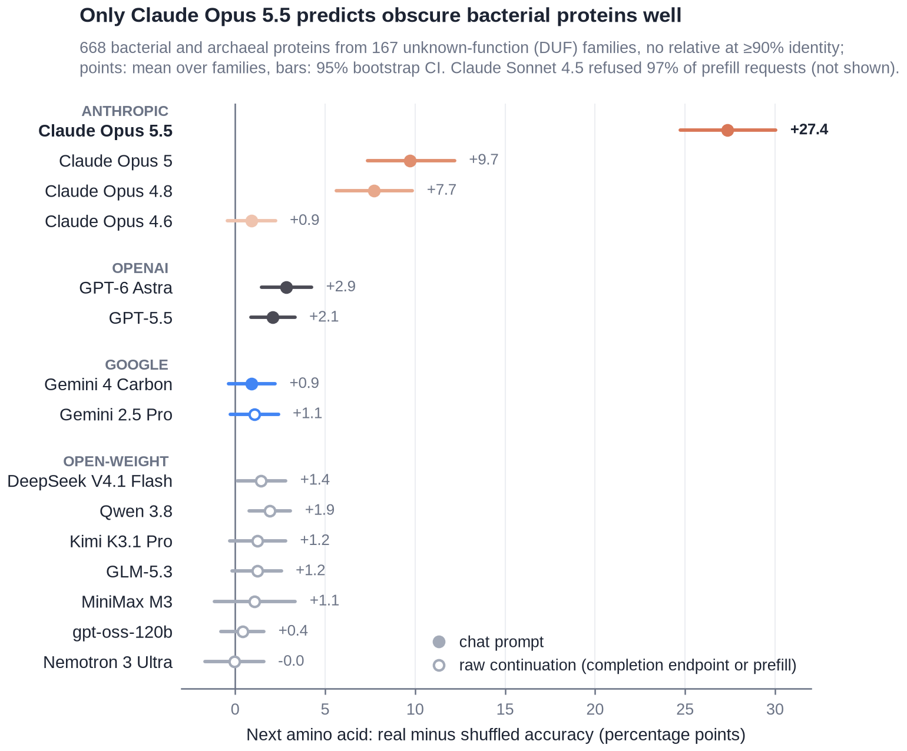
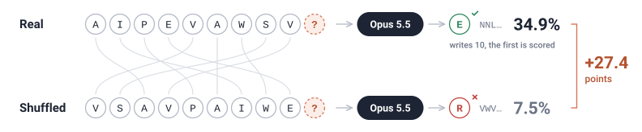

# LLM-bioseq-probe

Is protein or DNA sequence data in a language model's training data? This repo tests it
from the outside, through each model's API, and finds a clear yes for the latest Claude models,
**Claude Fable 5.2** and **Claude Opus 5.5**, and no clear sign for any other model we tested.



## The test

Give a model the start of a protein and ask for the next amino acids.



- **Little-studied proteins.** 668 bacterial and archaeal proteins from 167
  "domain of unknown function" (DUF) Pfam families: no solved structure, almost no
  papers, and no other UniProt sequence within 90% identity. Reasoning and the
  literature cannot predict them; sequence data in training can.
- **A shuffled control.** Each question is asked again on the same protein with its
  residues shuffled: same composition, no order. The gap in next-amino-acid accuracy
  between the two is what the model has learned about residue order.
- **A fingerprint.** If the signal comes from sequence data, it grows with the number of
  sequences in a family.

## Results

| | Next amino acid, real vs shuffled | Gap, points (95% CI) |
|---|---|---|
| Claude Fable 5.2 (through OpenRouter) | 54.1% vs 9.0% | **+45.1 (42.5 to 47.6)** |
| Claude Opus 5.5 | 34.9% vs 7.5% | **+27.4 (24.7 to 30.0)** |
| Claude Fable 5.1 (through OpenRouter) | 21.4% vs 6.6% | +14.9 (12.6 to 17.2) |
| Claude Opus 5 | 17.5% vs 7.7% | +9.7 (7.3 to 12.2) |
| Claude Opus 4.8 | 15.5% vs 7.8% | +7.7 (5.5 to 9.8) |
| Claude Opus 4.7 | 16.1% vs 7.2% | +8.9 (6.9 to 11.1) |
| Claude Opus 4.5 and 4.6, GPT-5.5, GPT-6 Astra, GPT-6.1 Sol, Gemini 4 Carbon | | +0.6 to +2.9 |
| Gemini 2.5 Pro and 7 open-weight models, raw next-token continuation | | -0.0 to +1.9 |

- The gap grows with family size, as for a protein language model. With 90 smaller families
  added (20 to 300 proteins each, 257 families in all), Opus 5.5 goes from +8 to +37 points
  and ProtGPT3-10B from +3 to +37; Fable 5.2 rises from +20 and levels off near +45 from about
  300 proteins per family. Every Claude model from Opus 4.7 on follows the trend (Spearman 0.30
  to 0.50); GPT and Gemini stay at zero ([figure](figures/fig5_family_size.png)). The gap is the
  same in the 128 families with zero papers.
- Given the same input (the residues before the cut), Fable 5.2 beats every open protein language
  model we ran: ProGen3-3B +32.5, ProtGPT3-10B +27.7, ESM C 600M +13.0, ProtGPT3-1.3B +11.6,
  ProtGPT2 +10.2, ESM3-open +8.5, ESM-2 650M +7.0. Opus 5.5 (+27.4) is level with ProtGPT3-10B.
  ProtGPT3-10B also follows the same family-size curve ([figure](figures/fig6_protein_lm.png)).
- It is not test-time reasoning: the API reports thinking tokens on only 9% of Fable 5.2's
  answers and 36% of Opus 5.5's, and the answers without thinking are just as accurate. Nor is
  it the prompt format (copy-then-continue gives the same result).
- **DNA:** Opus 5.5 predicts human and mouse coding sequence (25 exact 20-nucleotide
  continuations in 500 human windows) but not promoters, introns, intergenic DNA, or the
  bacterial genes behind the proteins above ([figure](figures/fig2_dna.png)).
- **Well-known proteins prove little:** several Claude and Gemini models recite hundreds
  of residues of famous proteins letter for letter
  ([figure](figures/fig4_recall.png), [comparison](figures/fig3_known_vs_obscure.png)).

What this does not show: whether the sequences came from a deliberate dataset or crawled
database pages, in which training phase, or that other models never saw sequences.
Details: [docs/findings.md](docs/findings.md); method: [docs/methods.md](docs/methods.md).

Motivated by [Atharv Jayprakash's SOD1 post](https://x.com/atharvjay872/status/2121477118450340342)
and [PG-LLM](https://www.proteingymllm.com/).

## Test a new model

```bash
uv sync
cp .env.example .env                                         # add the API keys you need
uv run probe-model --model claude-opus-5-5                   # dry run: counts the questions
uv run probe-model --model <id> --provider anthropic --run   # 6,680 questions, then the gap
```

Providers: `anthropic`, `openai_chat`, `openai_responses`, `gemini`, `fireworks`. A full run
costs roughly $1 to $20, depending on the model's price and how much it thinks.

## Layout

```
src/bioseq_probe/   API clients, prompts, scoring, shuffles, a .2bit reader, the probe-model CLI
scripts/data/       build the test sets (UniProt, InterPro, Europe PMC, GENCODE, UCSC, ENA)
scripts/probe/      ask the models (chat, raw continuation, DNA, recall length, protein LMs)
scripts/analysis/   the statistics behind every number above
scripts/figures/    the figures in figures/ (method_svg.py draws the method, publication.py the five data figures)
scripts/tools/      cost tally, model listing, smoke tests, output export
data/               the test sets (TSV)
results/            summary tables; outputs/ holds every model reply (gzipped JSONL)
docs/               findings, methods, and the analysis plan written before the main runs
```

Run scripts from the repo root. Rebuilding the DNA windows needs UCSC `hg38.2bit` and
`mm39.2bit` and GENCODE v50 and vM39 basic annotation in `data/genomes/`.

## License

MIT
